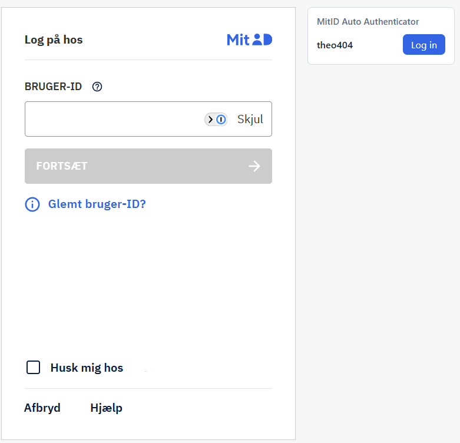
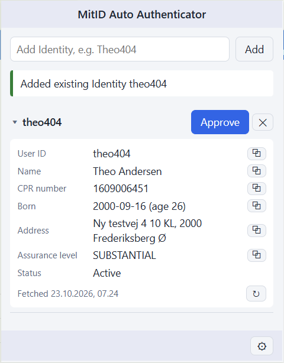

# MitID Auto Authenticator (browser extension)

Approves MitID pre-production Login requests for your test Identities, so testing MitID login flows doesn't need a phone or the MitID test tool. It's the browser version of [MitIdAutoAuthenticator](https://github.com/ChristianMorup/MitIdAutoAuthenticator). See [GLOSSARY.md](GLOSSARY.md) for the terms used.

<p>
  
  
</p>

Works in Chrome, Edge and Brave (Manifest V3).

## Install

```sh
npm install
npm run build
```

Then load the `dist` folder as an unpacked extension:

| Browser | Extensions page |
| ------- | --------------- |
| Chrome  | `chrome://extensions` |
| Edge    | `edge://extensions`   |
| Brave   | `brave://extensions`  |

Turn on **Developer mode**, click **Load unpacked** and pick `dist`. Pin the extension to the toolbar. After pulling changes, run `npm run build` again and click the reload icon on the extension.

## Add the MitID admin credential yourself

This repo does not contain the credential for the MitID pre-production admin API, and you need it to add Identities. Approving logins for Identities already in your list works without it.

1. Get a client ID and client secret for the MitID pre-production admin API yourself. They're not provided here.
2. Open the options page with ⚙ in the popup.
3. Enter both values under **MitID admin credential** and click **Save**.

The credential is stored in your browser profile only. Never commit it to this repo.

## Use

1. Click the toolbar icon to open the popup. Approving keeps running in the background if the popup closes, and reopening it shows the latest result.
2. Type a MitID user ID (e.g. `Theo404`) and press Enter to add an Identity:
   - If it exists in MitID pre-production and has a Simulator, it's just added to your list.
   - If it exists without a Simulator, a Simulator is created for it.
   - If it doesn't exist, a new Identity is created with mock data. Check the spelling: a typo creates a new Identity.
3. On the MitID login page of the site you're testing, open the popup and click **Log in** next to the Identity. The extension logs in as that Identity and approves the Login request, and the page continues as if you had used the MitID box. **Log in** only shows when the current tab is a MitID login page it supports (the Nets eID Broker on `netseidbroker.pp.mitid.dk`). The status line shows which service you logged in to.

The login page also gets a **MitID Auto Authenticator** panel beside the MitID box, listing your Identities with a **Log in** button each, so you don't need the popup. Its status line shows how the login went.

**Approve** only approves, for when you've entered the user ID yourself. It checks for a pending Login request every 2 seconds for about 15 seconds.

The list keeps the Identity you logged in with or approved most recently at the top; newly added Identities start at the top too. The toolbar badge shows `…` while a login or approval runs, then `✓` or `✗`. ✕ removes an Identity from your list only; it stays in MitID.

Click an Identity's name to expand its details:
- user ID, name, CPR number, date of birth with age, address, email and assurance level, each with a copy button;
- its status, plus a ⚠ on the row when the Identity or its CPR registration isn't active, or its name or address is protected.

The details are looked up in MitID the first time, which needs the admin credential, and then saved with the Identity. ↻ looks them up again.

## Options

Open the options page with ⚙ in the popup.

- **MitID admin credential.** The client ID and secret used to add Identities. See [Add the MitID admin credential yourself](#add-the-mitid-admin-credential-yourself).
- **Import / export.** Paste the lines of the console or Windows app's `mitid_users.txt` (`userId,identityId,authenticatorId`) and click Import to bring your existing Identities over. Export puts your list in the same format.

## How it works

Each Identity has a Simulator: a simulated MitID code app created through the MitID test API. Approving a Login request calls the Simulator's endpoints on `pp.mitid.dk` in the same order the phone app would: `auth-key` → `pull` → `perform-auth` (PIN `112233`) → `confirm`. Those calls need no credential; only adding Identities uses the admin credential.

**Log in** doesn't use the MitID box on the page; MitID blocks automated input there. Instead it reads the session data the broker gives the box (`#clientInfoAux`) and runs MitID's web client protocol itself: it identifies the user, starts an app login, approves it through the Simulator and completes the SRP key exchange. It then puts the resulting authorization code in the page's `#AuthCode` field and submits `#loginForm`, just as the MitID box would. The protocol isn't documented by MitID; the implementation is ported from [mitid-cli](https://github.com/Saturate/mitid-cli) (see [THIRD-PARTY-NOTICES.md](THIRD-PARTY-NOTICES.md)) and may need updating if MitID changes its web client.

The extension only polls when you ask it to approve. The original console app polled constantly, and running it for long periods risks getting your IP temporarily banned from the MitID test tool.

## Develop

```sh
npm test         # Vitest: mitid_users.txt parsing and the approve flow against a faked MitID
npm run build    # tsc → dist, plus the static files
npm run package  # build, then zip dist to release/mitid-auto-authenticator-<version>.zip
```

To release, bump `version` in `static/manifest.json`, run `npm run package` and share the zip. Users unzip it and use Load unpacked, so they don't need Node or the code. The zip has no credential either; everyone adds it in Options.

- `src/background.ts` is the service worker. It handles the commands from the popup and the login page panel.
- `src/mitid/` holds the MitID API calls.
- Pages and the manifest live in `static/`.
